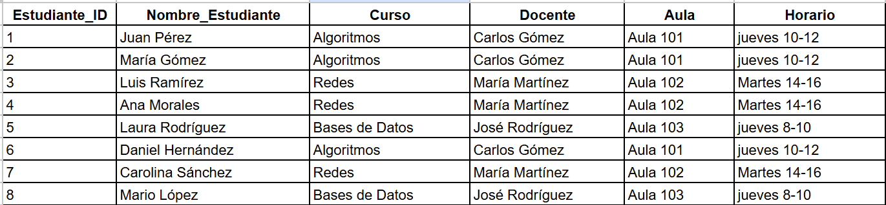
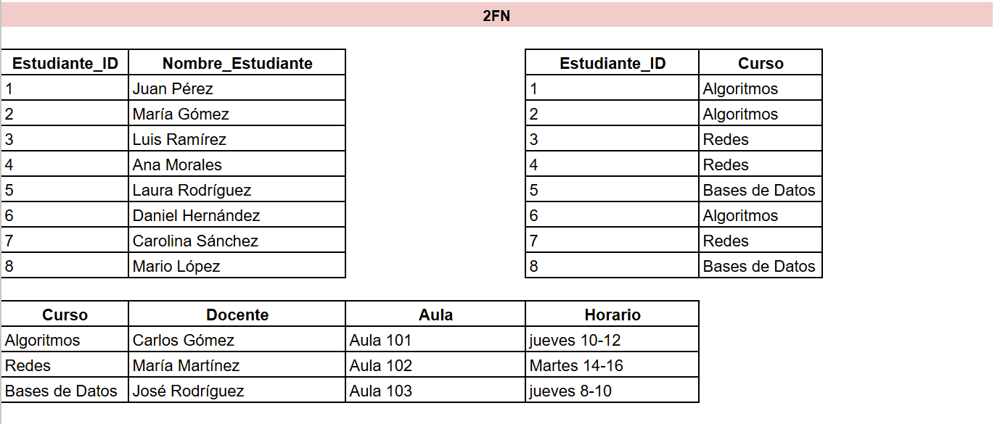
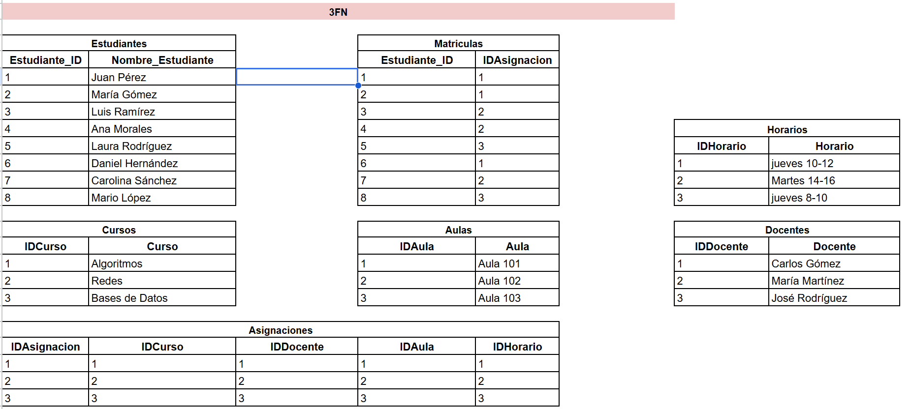

# Taller de Normalización - Universidad

En este taller se realizó la normalización de una BD para un sistema de gestión de matriculas, docentes y horarios de una universidad. El objetivo es realizar la normalización de la tabla original para eliminar la redundancia de datos y hacer que la base de datos sea más eficiente e integra.

## Explicación de la Normalización

### Primera Forma Normal (1FN):
La tabla original ya estaba en la primera forma normal (1FN), pero aún tenía toda la información mezclada en una sola tabla. 

### Segunda Forma Normal (2FN):
Para eliminar las dependencias parciales que habían los datos que dependían solo del estudiante se movieron a una nueva tabla llamada Estudiantes, se creó una tabla intermedia para manejar la relación muchos a muchos entre estudiantes y cursos y los datos que dependían del curso (Docente, Aula, Horario) se mantuvieron en una tabla aparte.

### Tercera Forma Normal (3FN):
Se eliminaron las dependencias transitivas creando una nueva tabla llamada Asignacion donde se colocaron los datos del docente, aula y horario para que ya no dependen directamente del estudiante. Se crearon tablas independientes para Docentes, Aulas y Horarios. Adicional, la tabla Matriculas se modificó para relacionar a los estudiantes con la Asignacion en lugar de con el Curso.

## Archivos SQL

En este repositorio se incluyen los siguientes archivos:

* DDL_Normalizacion.sql: Con las sentencias para crear la base de datos y las tablas.
* DML_Normalizacion.aql: Con las sentencias para insertar los datos de la tabla original.
* DQL_Normalizacion.sql: Con las 5 consultas creadas para probar la BD.
